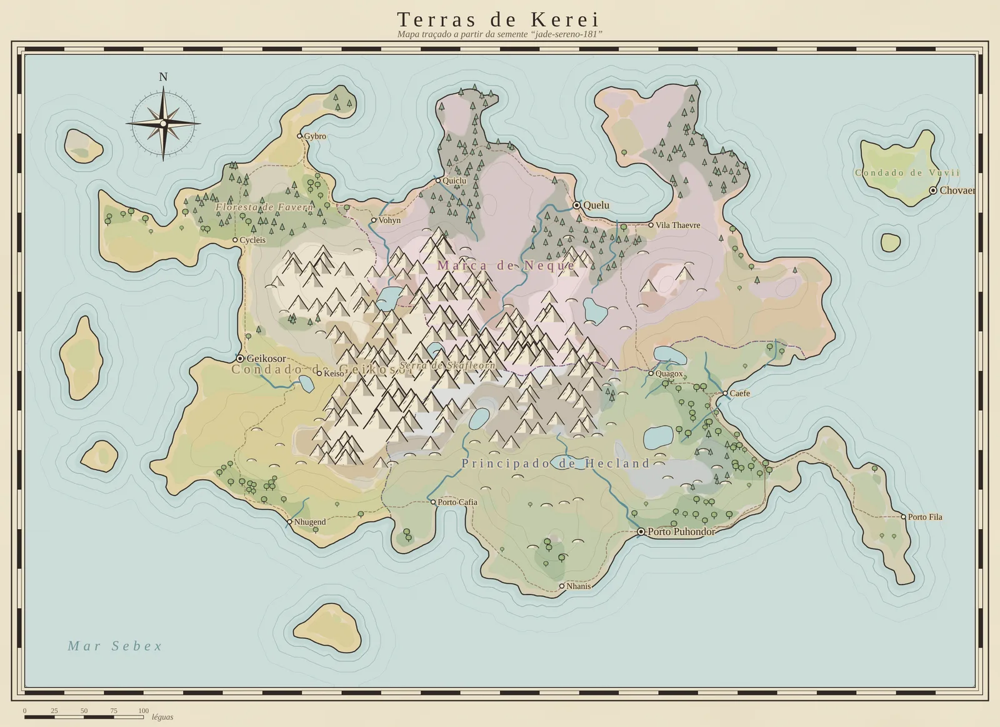
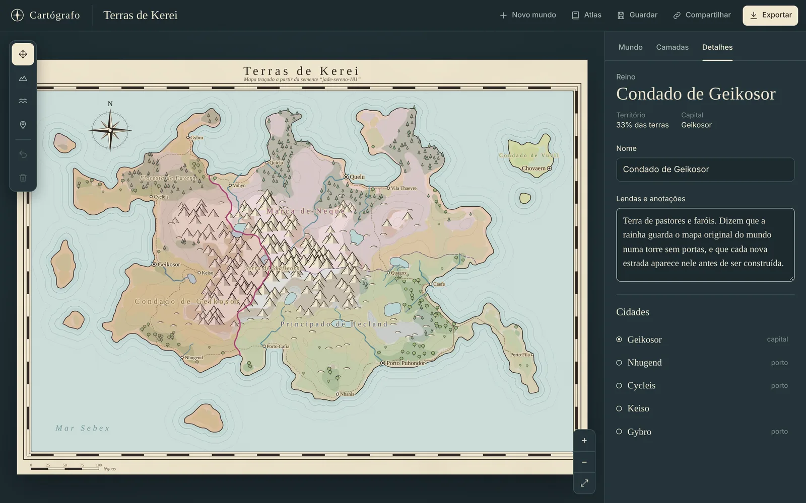
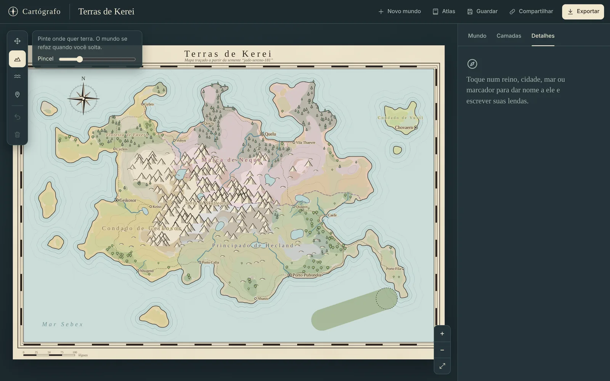
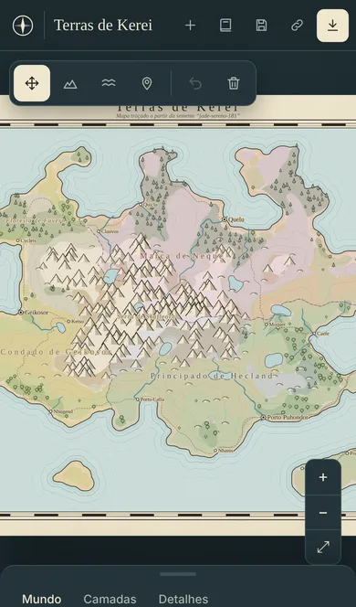

# Cartógrafo

Gerador de mapas de mundos fictícios. Você esboça o contorno de uma ilha e o Cartógrafo desenha relevo, rios, biomas, reinos, cidades e estradas, tudo a partir de uma semente. Depois é só dar nome aos lugares, escrever as lendas de cada um e compartilhar o mundo por link.



## O que dá para fazer

- **Gerar mundos por semente**: a mesma semente sempre desenha o mesmo mapa. Dá para escolher entre ilha, arquipélago e continente e ajustar nível do mar, montanhas, rios, umidade, temperatura, cidades e reinos.
- **Esboçar com pincel**: pinte terra ou mar direto no mapa. A mudança é local, então o resto do mundo (nomes, montanhas, cidades) continua igual.
- **Dar nome e escrever lendas**: clique em qualquer reino, cidade, mar ou cordilheira para renomear e escrever anotações. Também dá para marcar lugares próprios, como ruínas e torres.
- **Compartilhar por link**: o mundo inteiro, com esboço, nomes e lendas, cabe na URL. Não precisa de servidor.
- **Atlas**: guarde seus mundos favoritos no navegador, com miniatura.
- **Exportar** em PNG para postar ou imprimir, ou em SVG para editar no Figma, Inkscape ou Illustrator.
- **Camadas**: liga e desliga biomas, relevo, rios, estradas, fronteiras, nomes e grade.
- Funciona no celular, com pinça para zoom e painel deslizante.

| Detalhes de um reino | Esboçando terra |
| --- | --- |
|  |  |

<p align="center"></p>

## Como o mapa é gerado

O gerador roda num Web Worker, para a interface não travar, e segue estas etapas numa grade de 192 × 128 células:

1. **Altura**: formas base (ilha, arquipélago ou continente) deformadas por ruído simplex, com fractal noise para detalhes e ridged noise para cordilheiras. O esboço do usuário puxa a altura para cima ou para baixo só onde foi pintado.
2. **Água**: o algoritmo *priority-flood* enche as depressões e define para onde cada célula escoa. Depressões grandes viram lagos.
3. **Clima**: a umidade depende de ruído e da distância até o mar. A temperatura depende da latitude e da altitude.
4. **Rios**: o escoamento é acumulado de cima para baixo. Onde passa de um limite, vira rio, mais grosso conforme recebe afluentes.
5. **Biomas**: tabela de altitude × temperatura × umidade (deserto, estepe, campos, floresta, selva, taiga, tundra, pântano, montanha e neve).
6. **Cidades**: cada célula recebe uma nota por fertilidade, costa, rio e altitude. As melhores viram cidades, com distância mínima entre elas.
7. **Reinos**: as capitais são escolhidas por amostragem do ponto mais distante. O território se espalha por Dijkstra, com custo maior em serras e travessias de rio.
8. **Estradas**: A* entre cidades vizinhas, reaproveitando estradas que já existem.
9. **Nomes**: cada região do mapa tem um "dialeto" próprio (sílabas, vogais e terminações), por isso as cidades próximas soam parecidas.

O desenho é todo em SVG: contornos suavizados com d3-contour e Chaikin, aquarela com filtros `feTurbulence`, e símbolos de montanha, árvore e cidade no estilo dos mapas antigos.

## Stack

| | |
| --- | --- |
| Interface | React 18, TypeScript, Vite, Zustand, CSS Modules |
| Geração | Web Worker, simplex-noise, d3-contour, d3-shape |
| Compartilhamento | lz-string (estado comprimido na URL), localStorage para o atlas |
| Qualidade | Vitest, ESLint, GitHub Actions |

## Estrutura

```
src/
├── gen/        gerador procedural (terreno, água, biomas, cidades, reinos, nomes)
├── map/        desenho do mapa em SVG, símbolos, ornamentos e zoom
├── ui/         barra superior, ferramentas, painel, atlas e controles
├── store/      estado global com Zustand
├── share/      codificação do mundo para o link
├── lib/        worker, exportação, atlas e sincronização com a URL
└── styles/     tokens e estilos base
test/           testes do gerador e do link
```

## Como rodar

Requer Node 20+.

```bash
npm install
npm run dev
```

Abra http://localhost:5173.

Outros comandos:

```bash
npm test
npm run lint
npm run typecheck
npm run build
```

## Atalhos

| Tecla | Ação |
| --- | --- |
| V | Mover e escolher |
| T | Esboçar terra |
| M | Esboçar mar |
| P | Marcar um lugar |
| [ e ] | Diminuir e aumentar o pincel |
| Ctrl + Z | Desfazer esboço |
| + e − | Aproximar e afastar |
| 0 | Ver o mapa inteiro |
| Esc | Voltar para mover |

## Deploy

É um site estático, então dá para publicar direto na Vercel: importe o repositório e clique em Deploy. O `vercel.json` já está configurado.
